# 🚀 Awesome Career Tracking & Job Application Automation

  

  
  
  
  
  
  

---

## 🧭 Executive Summary & SEO Keywords

> **Curated directory of SaaS job trackers, open-source AI resume builders, ATS keyword optimizers, browser autofill extensions, and autonomous job application agents.**  
> *Target keywords: job application tracker, career tracking CRM, ATS resume checker, AI cover letter generator, automated job applications, open-source resume builder, JSON resume, RenderCV Typst, JobSpy scraper.*

**Last updated:** November 2026

This repository indexes the highest-performing **SaaS platforms** and **open-source GitHub repositories** designed to organize pipelines, optimize resumes against Applicant Tracking Systems (ATS), autofill high-volume job applications, scrape listings, and run local privacy-first AI agents.

---

## 📑 Table of Contents

- [📊 Sector Overview & Market Dynamics](#-sector-overview--market-dynamics)
- [💼 SaaS & Hosted Platforms](#-saas--hosted-platforms)
- [💻 Open-Source GitHub Projects](#-open-source-github-projects)
- [🛠️ Developer Automation & Orchestration Stack](#️-developer-automation--orchestration-stack)
- [📈 Star History](#-star-history)
- [🤝 How to Contribute](#-how-to-contribute)
- [☕ Support & Share](#-support--share)
- [⚠️ Disclaimer](#️-disclaimer)

---

## 📊 Sector Overview & Market Dynamics

The global Career Management, Resume Building & Job Application Automation market is estimated at **$3.8B to $5.2B**, expanding rapidly alongside AI-driven HR tech and automated recruitment workflows.

The sector is **moderately fragmented**: while foundational workflow leaders (such as Teal, Jobscan, and EarnIn's EarnBetter) command substantial subscriber footprints in desktop tracking and ATS parsing, there is no single "winner-take-all" incumbent due to constant shifts in job board bot defenses, diverse candidate formatting needs (LaTeX/Typst vs. GUI drag-and-drop), and an explosive surge in autonomous open-source agent ecosystems.

---

## 💼 SaaS & Hosted Platforms

> [!NOTE]
> Sorted by company size (valuation, estimated ARR, or total funding) in descending order. Free tier limits and starting pricing reflect verified plans.

| Product | Company Size (Valuation / Revenue / Funding) | Starting Paid Pricing | Free Tier / Trial Limits | Description |
| :--- | :--- | :--- | :--- | :--- |
| **[EarnBetter](https://earnbetter.com)** | **$590M+ valuation** / ~$93.6M ARR *(Acquired by EarnIn; $518M total funding)* | **Free** ($0 / 100% employer-funded model) | **Free forever with full access** (Unlimited AI resume tailoring, cover letters, and job tracking; no paywalls) | 🤖 AI-assisted job search and document tailoring platform that reformats resumes, drafts custom cover letters, and curates matching job listings. |
| **[Sonara](https://sonara.ai)** | **$100M+ parent scale** *(Acquired by BOLD LLC; previously raised ~$5.8M)* | **$23.95 / 4 weeks** (or $71.40/yr) | **14-day trial or first 10 automated job applications** (whichever comes first, via $2.95 introductory trial) | ⚡ AI job-matching and automated application service that continuously scans job boards for role fit and queues applications on behalf of candidates. |
| **[Teal](https://tealhq.com)** | **$20.7M funding** / ~$10M–$15M est. ARR *(Series A backed by Flybridge & CityLight)* | **$9 / week** (or $29/mo, $79/quarter, $179/yr) | **Free forever with limits** (Unlimited job tracking, unlimited basic resume exports, 10 resume templates, top 5 keywords per job description, 5 one-time AI bullet credits, 2 one-time AI summary credits, 2 one-time AI cover letter credits) | 📋 All-in-one career growth platform combining a multi-board job application tracker, AI resume keyword matcher, and tailored bullet-point generator. |
| **[Careerflow.ai](https://careerflow.ai)** | **~$5.6M–$8.1M ARR** *(Seed/Techstars-backed)* | **$23.99 / month** (or $14.41/mo billed annually) | **Free forever with limits** (Up to 10 jobs tracked on CRM board, 1 resume creation/import with basic ATS score; AI cover letter/email writers and one-click optimizer locked) | 🧭 AI-powered job search copilot offering a CRM application tracker, LinkedIn profile optimizer, autofill browser extension, and networking outreach templates. |
| **[Jobscan](https://jobscan.co)** | **~$3.8M–$7.6M ARR** *(Bootstrapped & profitable)* | **$49.95 / month** (or $89.95/quarter with 7-day free trial) | **Free forever with limits** (5 resume & ATS scans per month, condensed ATS/recruiter findings report, basic job tracker; unlimited AI optimization locked) | 🎯 Applicant Tracking System (ATS) optimization platform that scores resumes and cover letters against job descriptions to surface missing skills and formatting issues. |
| **[Kickresume](https://kickresume.com)** | **~$1.9M–$4.4M ARR** / ~$100K seed *(VentureOut backed)* | **$19 / month** (or $13/mo billed quarterly, $8/mo billed annually) | **Free forever with limits** (4 basic resume templates, 4 cover letter templates, 1 basic website template, unlimited PDF downloads; AI resume writer and ATS checker locked) | 📄 Cloud-based AI resume, cover letter, and personal website builder featuring customizable templates, ATS checks, and career map tools. |
| **[Rezi](https://rezi.ai)** | **~$2.9M–$3.2M ARR** / ~$338K early funding *(Bootstrapped SaaS)* | **$29 / month** (or $19/mo billed quarterly, $149 lifetime) | **Free forever with limits** (1 active resume, up to 3 lifetime PDF downloads, basic ATS keyword targeting, 1 AI interview practice session) | 🔍 AI-driven resume builder focused on strict ATS formatting compliance, real-time content scoring, and automated keyword targeting. |
| **[Jobseeker](https://jobseeker.com)** | **Multi-million est. ARR** *(Operated by Resumedia B.V., Amsterdam)* | **$19.99 / month** (after 14-day introductory trial) | **14-day full-access trial** ($0.99 intro fee; auto-renews at $19.99/mo unless cancelled; creates/edits resumes and cover letters with job tracking) | 🗂️ Cloud career toolkit providing structured resume/CV builders, cover letter generators, job alerts, and application status tracking. |
| **[Huntr](https://huntr.co)** | **~$1M+ ARR** *(Bootstrapped / Product-led)* | **$40 / month** (or $90/3-mo, $160/6-mo) | **Free forever with limits** (Up to 100 tracked jobs on Kanban board, unlimited Chrome application autofills, up to 100 document uploads, unlimited basic resume PDF exports, but capped at 2 AI-tailored resumes and 2 AI application packets) | 📌 Kanban-style job application tracker, browser extension clipper, AI resume builder, and contact/interview organizer designed for managing active job searches. |
| **[LazyApply](https://lazyapply.com)** | **Bootstrapped niche scale** *(Unfunded, founder-owned)* | **$99 / year** (Basic plan, annual billing) | **No free tier** (Full access requires paid plan; Basic is capped at 15 automated applications/day across 1 profile, Premium at 150/day across 5 profiles; 30-day conditional money-back policy) | 🤖 Automated job application browser extension designed to autofill and submit high-volume applications across LinkedIn, Indeed, and ZipRecruiter. |

---

## 💻 Open-Source GitHub Projects

> [!TIP]
> The primary open-source career tracking and application tools below are sorted in descending order by GitHub stargazer count. Badges link directly to each project's stargazers community.

1. **[career-ops-hq/career-ops](https://github.com/career-ops-hq/career-ops)**   
   🤖 Open-source autonomous AI job search agent and job finder. Scans job boards, scores postings (1-5) against candidate CVs, tailors ATS-friendly resumes and cover letters, assists with application filling, and manages pipeline tracking.

2. **[AmruthPillai/Reactive-Resume](https://github.com/AmruthPillai/Reactive-Resume)**   
   📄 Flagship privacy-first, open-source resume builder with real-time live preview, multi-language support, JSON export/import, customizable templates, and self-hosted Docker deployment.

3. **[feder-cr/Jobs_Applier_AI_Agent_AIHawk](https://github.com/feder-cr/Jobs_Applier_AI_Agent_AIHawk)**   
   ⚡ Python and Playwright/Selenium automated job application bot that integrates LLMs to auto-fill Easy Apply forms, tailor responses, and process high-volume application pipelines.

4. **[srbhr/Resume-Matcher](https://github.com/srbhr/Resume-Matcher)**   
   🎯 AI-powered ATS resume analyzer and matcher using vector embeddings and local LLMs to benchmark resumes against job descriptions, surfacing keyword coverage gaps.

5. **[posquit0/Awesome-CV](https://github.com/posquit0/Awesome-CV)**   
   ✨ Beautiful, widely adopted LaTeX template for software engineers, academics, and researchers seeking crisp, ATS-parsable, version-controlled resumes and cover letters in Git.

6. **[rendercv/rendercv](https://github.com/rendercv/rendercv)**   
   ⚙️ Typst/LaTeX-powered CLI engine converting structured, version-controlled YAML resume data into publication-quality, ATS-optimized PDF and Markdown documents.

7. **[xitanggg/open-resume](https://github.com/xitanggg/open-resume)**   
   🔍 Modern Next.js browser-based resume builder with an integrated real-time ATS parser preview, demonstrating precisely how automated enterprise parsers read your PDF layout.

8. **[speedyapply/JobSpy](https://github.com/speedyapply/JobSpy)**   
   🕷️ High-speed Python job scraper that concurrently aggregates structured postings across LinkedIn, Indeed, Glassdoor, ZipRecruiter, and Google Jobs into Pandas DataFrames.

9. **[jsonresume/resume-cli](https://github.com/jsonresume/resume-cli)**   
   💻 Official command-line interface for JSON Resume, supporting local schema validation, live preview server, and export to HTML, PDF, and theme templates.

10. **[jsonresume/resume-schema](https://github.com/jsonresume/resume-schema)**   
    📐 Community open JSON Schema defining standardized, portable resume data with hundreds of community themes and integrations.

11. **[yamlresume/yamlresume](https://github.com/yamlresume/yamlresume)**   
    📝 Resumes-as-code generator compiling human-readable YAML configurations into polished HTML, PDF, and LaTeX resumes.

---

## 🛠️ Developer Automation & Orchestration Stack

Enhance your career tracking pipeline by pairing job application tools with open-source workflow automation engines:

* **[n8n-io/n8n](https://github.com/n8n-io/n8n)**  — Self-hosted fair-code workflow automation platform to trigger automated email scrapers, webhook alerts, and Airtable/Notion pipeline updates.
* **[ollama/ollama](https://github.com/ollama/ollama)**  — Run local LLMs (Llama 3, Mistral, Qwen) on your workstation for zero-latency, private resume tailoring and interview question generation.
* **[yangshun/tech-interview-handbook](https://github.com/yangshun/tech-interview-handbook)**  — Curated technical interview roadmaps, resume rubrics, behavioral answers, and offer negotiation frameworks.
* **[duckdb/duckdb](https://github.com/duckdb/duckdb)**  — Embedded columnar analytical database ideal for querying millions of scraped job listings from JobSpy locally via SQL.
* **[dgtlmoon/changedetection.io](https://github.com/dgtlmoon/changedetection.io)**  — Self-hosted webpage change detection alerting you the moment target company career portals open new roles.

---

## 📈 Star History

---

## 🤝 How to Contribute

Contributions are warmly welcomed! Help expand this directory:

1. **Fork the repository** to your GitHub account.
2. **Add or refine an entry** in `README.md` adhering to the table or list schema.
3. **Validate links and Stars_Counts** to maintain quality and accuracy.
4. **Submit a Pull Request** with a succinct description of the tool.

---

## ☕ Support & Share

Thank you for exploring and utilizing this collection! If this ecosystem guide simplifies your career management or job automation workflow, please consider supporting the project:

- ⭐ **Star this repository** to boost visibility for fellow job seekers and developers.
- 🍴 **Fork and share** with colleagues, alumni networks, and developer communities on LinkedIn, X/Twitter, and Reddit.
- ☕ **Buy me a coffee & sponsor my open-source work**: Support continuous curation and development on my [GitHub Sponsor Dashboard](https://github.com/sponsors/ishandutta2007) — featuring profile badges, README acknowledgments, and priority feature reviews!

---

## ⚠️ Disclaimer

- This is a community-curated directory intended for educational, research, and productivity purposes; inclusion does not constitute endorsement.
- Users deploying automated job application agents or web scrapers must comply with all target platform Terms of Service, rate limits, and anti-abuse policies.
- Never store sensitive unencrypted personally identifiable information (PII), national IDs, or credentials in public repositories.

---

  <b>Built for job seekers, software engineers, and career technologists worldwide. 🚀</b>

